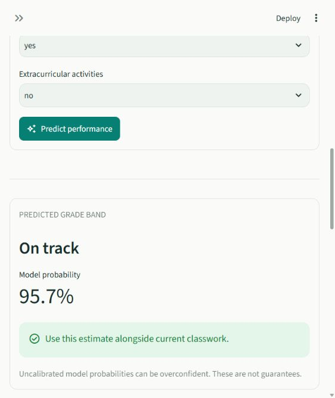
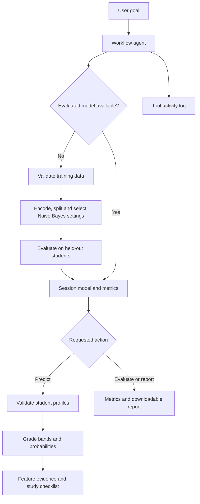

# ScholarSignal

### Student Performance Prediction Using Naive Bayes

**ScholarSignal** is an AI lab project that predicts student performance using Categorical Naive Bayes. A goal-driven workflow agent coordinates data validation, model selection, evaluation, prediction, explanation, and study-support checklists through an interactive Streamlit app.

**Python · Streamlit · scikit-learn · pandas · Altair**

No Groq, Gemini, API key, or internet connection is needed after installation. The public dataset is bundled, models are trained when a session starts, and the app runs locally.

[Quick start](#quick-start) · [Features](#features) · [How the agent works](#how-the-agent-works) · [Results](#measured-results) · [Lab report](docs/LAB_REPORT.md) · [Viva guide](docs/VIVA_GUIDE.md)

## Quick start

Requirements: **Python 3.12 or 3.13**, Git, and an internet connection for the initial package installation.

### Windows

Install Python with **Add Python to PATH**, then run:

```powershell
git clone https://github.com/abhishelke1/ScholarSignal.git
cd ScholarSignal
.\setup.bat
.\start.bat
```

After setup, you can also double-click `start.bat`. Open **http://localhost:8501** if the browser does not open automatically. Keep the terminal open while using the app; press **Ctrl+C** to stop it.

For manual installation:

```powershell
python -m venv .venv
.\.venv\Scripts\python.exe -m pip install -r requirements-dev.txt
.\.venv\Scripts\python.exe -m streamlit run app.py
```

### macOS / Linux

```bash
git clone https://github.com/abhishelke1/ScholarSignal.git
cd ScholarSignal
python3 -m venv .venv
source .venv/bin/activate
python -m pip install -r requirements-dev.txt
python -m streamlit run app.py
```

The environment is machine-specific: recreate `.venv` on each computer. Streamlit usage telemetry is disabled, and the server binds to `127.0.0.1` by default.

## Features

| Section | What you can demonstrate |
| --- | --- |
| Overview | Real dataset, model metrics, grade-band distribution, agent commands and activity |
| Predict a student | Individual prediction, all class probabilities, exact Naive Bayes evidence, study checklist |
| Batch predictions | CSV upload, validation, missing-value handling, review flags and CSV download |
| Model insights | Confusion matrix, class precision/recall/F1, baseline, cross-validation and JSON report |
| Lab guide | Algorithm, agent architecture, demonstration sequence, limitations and viva questions |

### App preview

An example prediction from the running app. The displayed probability is an uncalibrated estimate for that profile, not the model's overall accuracy.



## Measured results

Bundled UCI mathematics dataset, 395 rows; fixed stratified 80/20 split with seed 42; 316 training rows and **79 held-out test rows**. These are observed results, not promises for another dataset.

| Mode | Test accuracy | Test macro F1 | Selected alpha |
| --- | ---: | ---: | ---: |
| With prior grades (G1, G2) | 86.1% | 0.868 | 2.0 |
| Early warning (without G1, G2) | 41.8% | 0.399 | 0.5 |
| Majority-class baseline | 41.8% | 0.196 | — |

The early-warning model matches baseline accuracy, although its macro F1 is higher. This is a useful limitation to discuss in your viva. Early warning excludes grades but does not prove that every other field was available early in the school year.

## How the agent works

It is a **bounded, goal-driven workflow agent**. The controller observes whether data and a model are available, selects tools needed for the goal, executes them, stores state, and logs outcomes. A prediction request triggers training if needed; invalid input blocks the relevant action; an existing evaluated model is reused. The prediction model learns from data.

The planning policy and command parser are deterministic; the predictive model learns from data. This implementation is a **bounded workflow agent**, with explicit tool selection and state management. It does not use an LLM or perform open-ended autonomous planning.



Supported commands: `run analysis`, `evaluate model`, `explain naive bayes`, `export report`, `predict student`. Use the student form for profile values.

## Data format

Training requires the following columns plus `G3`. Predictions require the same features but never use `G3`. Early-warning mode does not require `G1` or `G2`.

| Column | Accepted values |
| --- | --- |
| `studytime` | 1: <2 hours/week; 2: 2–5; 3: 5–10; 4: >10 |
| `failures` | Integer 0–3, matching observed UCI data |
| `absences` | Integer 0–93 |
| `traveltime` | 1: <15 min; 2: 15–30; 3: 30–60; 4: >60 |
| `schoolsup`, `famsup`, `activities`, `higher`, `internet` | `yes`, `no`, or blank |
| `G1`, `G2` | Integer grade 0–20, when prior grades are used |
| `G3` | Integer final grade 0–20; training target only, never blank |
| `student_id` | Optional batch reference; preserved in exported predictions |

Both comma and semicolon separators are supported. Use UTF-8 encoding. Training needs at least 60 rows and 10 records in each target band. Upload limit: 5 MB and 10,000 rows. Blank feature values receive an explicit unknown category; an entirely blank student or training feature is rejected. Unknown yes/no values and out-of-range numbers are rejected rather than silently corrected.

Download training and prediction CSV examples from Overview. Extra columns are ignored by the classifier. Avoid direct identifiers in training data. Exact full-row duplicates are removed before splitting; repeated observations of a student with differing records still require your own deduplication or a grouped evaluation strategy.

The grade bands are project-defined: **Needs support = 0–9**, **On track = 10–13**, **Strong = 14–20**.

## Command-line agent

```powershell
# Train and write a reproducible evaluation report
.\.venv\Scripts\python.exe -m student_agent --report artifacts/with_prior_grades.json

# Evaluate without previous grades
.\.venv\Scripts\python.exe -m student_agent --early-warning --report artifacts/early_warning.json

# Use your own training data and predict a class
.\.venv\Scripts\python.exe -m student_agent --dataset training.csv --predict students.csv --output artifacts/predictions.csv

# Run the automated model and interface tests
.\.venv\Scripts\python.exe -m pytest -q
```

Reports contain model settings, metrics, class counts, a dataset SHA-256 fingerprint, limitations and tool trace. They do not include individual student records. Uploaded data and models stay in session memory; the app does not write them to disk. Downloads and explicit CLI outputs create files when requested. Models are retrained on a fresh app session; there is no unsafe pickle loading.

## Project structure

```text
app.py                   App entrypoint and session/data switching
app_pages/               Five interface sections
student_agent/data.py    CSV contracts, grade bands, fixed encoding
student_agent/model.py   Training, evaluation, prediction, explanation
student_agent/agent.py   Goal controller, memory, tools, activity log
student_agent/ui.py      Shared interface helpers
student_agent/__main__.py Command-line agent
data/                    Original UCI dataset and provenance
docs/                    Lab report and viva guide
tests/                   Model invariants and Streamlit interaction tests
.streamlit/config.toml   Theme, local server and upload settings
start.bat / setup.bat    Windows launch and installation
```

## Academic scope

Feature independence is approximate, especially for correlated G1/G2. Model probabilities are uncalibrated. Evidence charts explain model log odds, not causal influence. Study plans use explicit rules, not learned intervention effects. Review flags use a demonstration threshold of 60% and are not validated risk decisions. This project supports discussion and teacher review, not admissions, grading or disciplinary decisions. The selected features omit sensitive demographics but do not establish fairness.

## References

- Cortez, P. (2008). [Student Performance](https://archive.ics.uci.edu/dataset/320/student+performance). UCI Machine Learning Repository. [DOI: 10.24432/C5TG7T](https://doi.org/10.24432/C5TG7T). Dataset licensed [CC BY 4.0](https://creativecommons.org/licenses/by/4.0/).
- [Scikit-learn Naive Bayes documentation](https://scikit-learn.org/stable/modules/naive_bayes.html).
- [Streamlit documentation](https://docs.streamlit.io/).

## Documentation and testing

- [Lab report](docs/LAB_REPORT.md): design, architecture, algorithm, evaluation and limitations.
- [Viva guide](docs/VIVA_GUIDE.md): demonstration sequence and questions to prepare.
- [Verification record](docs/VERIFICATION.md): test coverage and manual checks.
- [Dataset provenance](data/README.md): source, attribution and transformations.
- [Example prediction CSV](data/prediction_example.csv): five profiles for demonstrating batch input.

The verified suite contains **26 passing tests**. To run it after activating your environment:

```bash
python -m pytest -q
```

To create a source ZIP for submission:

```bash
python scripts/package_project.py
```

The archive is written to `artifacts/ScholarSignal-AI-Lab.zip`. Local environments, secrets, logs and generated outputs are excluded from Git.

### Troubleshooting

- **Python is not found:** install Python 3.12 or 3.13 and add it to PATH, then reopen the terminal.
- **Port 8501 is already in use:** open the existing app, stop its terminal with Ctrl+C, or run `python -m streamlit run app.py --server.port 8502`.
- **CSV validation fails:** use the example/template, match the field names and ranges above, and include G3 only when training.
- **AppTest stalls in a restricted Windows environment:** the test runner needs a local loopback socket. Run the tests in a normal local terminal.
