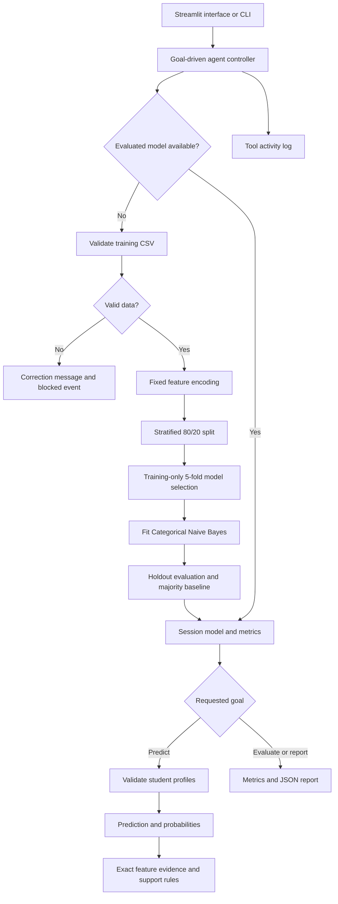

# Student Performance Prediction using Naive Bayes

## Abstract

This project implements a student performance classifier and a goal-driven software agent that coordinates its workflow. It uses Categorical Naive Bayes to estimate a final-grade band from study, support, absence and optionally previous-grade information. A Streamlit interface supports individual profiles, CSV batches, evaluation and model explanations. The controller is deterministic and maintains session state and a tool log. No large language model is required.

## Problem statement and objectives

The aim is to demonstrate how an AI system can turn structured student records into interpretable estimates for teacher review. The application must validate data, learn a classifier, evaluate unseen records, expose errors and limitations, and produce a simple support checklist.

The prediction target is a three-class band derived from final grade G3: Needs support (0–9), On track (10–13), and Strong (14–20). These bands are project definitions, not official institutional thresholds.

## Design and implementation plan

| Stage | Implemented output |
| --- | --- |
| Define the problem | Three-class prediction, separate prior-grade and early-warning modes |
| Acquire and inspect data | Original UCI mathematics records, source archive, input contracts |
| Build learning tools | Fixed categorical encoder, cross-validation, CategoricalNB, baseline and metrics |
| Build agent | Goal parser, state checks, tool dispatch, quality review and audit log |
| Build interface | Overview, individual and batch workflows, model insights, lab guide |
| Verify | Data edge cases, leakage boundaries, explanation arithmetic, UI interactions |
| Deliver | Local launcher, CLI reports, source code, dataset, instructions and viva guide |

## Architecture



The app separates the interface, data contract, model tools and controller into independent modules. The CLI uses the same controller as the interface. The agent's dataset/mode identity prevents reuse of a model after a data or mode change.

## Agent specification

The goal space is bounded: train, evaluate, predict and report. A simple command parser also explains the algorithm and routes users to profile entry. It does not interpret arbitrary conversational instructions or execute user-supplied code.

| Observed state | Controller action |
| --- | --- |
| No trained model | Validate, encode, split, select alpha, fit, evaluate |
| Invalid training data | Record a blocked event and explain the correction |
| Model already available for this data and mode | Reuse it |
| Prediction requested | Validate student records, call prediction, compute review flags |
| One student predicted | Explain feature evidence and generate a rule-based study plan |
| Macro F1 does not beat baseline | Add a quality-review event |
| Report requested | Export configuration, metrics, fingerprint, limitations and trace |

This is a goal-driven workflow agent whose decision policy is explicitly programmed. Machine learning occurs in the prediction tool. It should not be described as an LLM agent, general autonomous assistant, or reinforcement-learning agent.

## Data preparation

The demonstration uses 395 mathematics records from the UCI Student Performance dataset. The Portuguese subject is not merged because students overlap across subjects. The selected feature list excludes G3 and demographic/health attributes.

Predictors: studytime, failures, absences, traveltime, schoolsup, famsup, activities, higher and internet. The prior-grade mode adds G1 and G2. The target is derived exclusively from G3.

Validation accepts only whole numbers in documented ranges and yes/no categories. Missing features receive an unknown category; targets cannot be missing. Empty profiles, empty datasets, invalid values, completely blank training features and insufficient class support are rejected. Exact full-row duplicates are removed before splitting. This is not a substitute for grouping repeated records by student when the uploaded dataset contains longitudinal observations.

Encoding uses fixed bins:

| Feature | Categories before the extra unknown category |
| --- | --- |
| G1, G2 | 0–9; 10–13; 14–20 |
| Absences | 0; 1–5; 6–15; 16–93 |
| Study time, travel time | Original four ordinal codes |
| Failures | 0; 1; 2; 3 |
| Binary support/access features | no; yes |

These boundaries are specified independently of the dataset and therefore use no test-set statistics. In contrast, the category likelihoods and class priors are learned only from training records.

## Naive Bayes algorithm

For class c and input features x, Bayes' theorem and conditional independence give:

```text
P(c | x) ∝ P(c) × product_i P(x_i | c)
prediction = argmax_c P(c | x)
```

Categorical Naive Bayes estimates a separate discrete distribution for each feature in each class. Additive smoothing gives:

```text
P(feature_i = category_k | class_c)
    = (count_i,k,c + alpha) / (class_count_c + alpha × number_of_categories_i)
```

The code compares alpha 0.5, 1 and 2 using five-fold cross-validation on the training partition. It chooses the highest mean macro F1, fits that setting on all training rows, and evaluates once on the held-out test set. The prediction interface retains this same fitted model rather than silently refitting it on the test rows.

Training is approximately linear in the number of records times features for a fixed candidate/fold count. Prediction is approximately linear in records × classes × features. With this small dataset, training can occur at the beginning of a session and then be reused.

## Evaluation

Random seed 42; stratified 80/20 split; 316 training rows and 79 test rows. The majority baseline predicts the most frequent training class for every record.

| Model | Holdout accuracy | Macro F1 | Cross-validation macro F1 | Alpha |
| --- | ---: | ---: | ---: | ---: |
| Prior-grade Naive Bayes | 0.8608 | 0.8680 | 0.8609 | 2.0 |
| Early-warning Naive Bayes | 0.4177 | 0.3985 | 0.5054 | 0.5 |
| Majority baseline | 0.4177 | 0.1964 | Not selected | Not applicable |

Prior-grade confusion matrix, rows = actual and columns = predicted:

| Actual / Predicted | Needs support | On track | Strong |
| --- | ---: | ---: | ---: |
| Needs support | 23 | 3 | 0 |
| On track | 5 | 26 | 2 |
| Strong | 0 | 1 | 19 |

The prior-grade model classifies 68 of 79 test students correctly. Early-warning performance is substantially weaker and equals baseline accuracy. These are results from one small holdout, not validated performance for another school. The selected alpha's cross-validation score is a selection score and is not an independent final performance estimate.

## Explainability and support

For one student, the system compares the top class w with the runner-up r. Feature evidence is exactly:

```text
evidence_i = log P(x_i | w) − log P(x_i | r)
prior_evidence = log P(w) − log P(r)
log posterior odds = prior_evidence + sum_i evidence_i
```

The graph displays these terms. A positive term supports the top class relative to the alternative; it does not mean that changing that feature would improve outcomes. Probabilities are uncalibrated.

Study checklists use explicit rules for limited study time, recorded absences, past failures, and the predicted support band. They are suggestions for discussion, not learned or tested interventions. Review is recommended for a Needs support prediction, probability below 0.60, or a missing feature. The 0.60 cutoff is a demonstration heuristic.

## Verification

The automated suite covers grade boundaries, disjoint train/test indices, ignoring G3 during prediction, early-mode feature exclusion, invalid numeric and binary values, missingness, class-support limits, encoding consistency, probability normalization, exact reconstruction of explanation log odds, model reuse, deduplication, CSV parsing, safe CSV export, serializable reports, and interface workflows.

Run `python -m pytest -q` in the installed environment. Run `python -m student_agent` to reproduce evaluation output. The test runner requires local loopback sockets on Windows even when testing headlessly.

## Limitations and future work

The independence assumption is approximate and G1/G2 are correlated. Grade binning loses within-band information. Small sample size, a fixed random split, class imbalance and distribution shift limit generalization. Access/support features may carry social differences even though sensitive demographics are omitted. Early-warning fields require a temporal availability audit; recorded absences may be cumulative.

Future work could add grouped or temporal validation, probability calibration using training-only folds, fair-performance auditing, additional independently collected data, and institution-approved intervention evaluation. A Groq or Gemini explanation layer could be added if specifically required, but it should not replace Naive Bayes predictions or invent results.

## References

1. Cortez, P. (2008). [Student Performance dataset](https://archive.ics.uci.edu/dataset/320/student+performance). UCI Machine Learning Repository. https://doi.org/10.24432/C5TG7T. CC BY 4.0.
2. [Scikit-learn: Naive Bayes](https://scikit-learn.org/stable/modules/naive_bayes.html).
3. [Streamlit documentation](https://docs.streamlit.io/).
